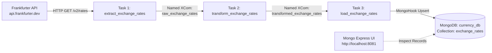

# Currency Exchange Rate ETL Pipeline

An automated, daily ETL (Extract, Transform, Load) data pipeline built with **Apache Airflow** (orchestrated via **Astro CLI**), integrating live currency exchange rates from the **Frankfurter API** into **MongoDB**, with administration through **Mongo Express**.

---

## 📌 Project Architecture



### Data Flow Overview:
1. **Extract**: Fetches latest daily exchange rates for EUR against USD, GBP, and JPY from the public Frankfurter API.
2. **Named XCom (Extract $\rightarrow$ Transform)**: Passes the raw API JSON array under the explicit key `raw_exchange_rates`.
3. **Transform**: Cleans, re-keys, and enriches each record with ISO-8601 UTC timestamps and attribution metadata.
4. **Named XCom (Transform $\rightarrow$ Load)**: Passes the cleaned document list under the key `transformed_exchange_rates`.
5. **Load**: Connects to MongoDB and performs an idempotent **upsert** (`replace_one(..., upsert=True)`) based on `(base_currency, target_currency, rate_date)` to avoid duplicate entries on re-runs.

---

## 🛠️ Tech Stack & Key Components

| Technology | Role |
| :--- | :--- |
| **Apache Airflow (v3 / Astro Runtime)** | Workflow orchestration, scheduling, and task dependency management |
| **Astro CLI** | Local container management and Airflow environment lifecycle |
| **Frankfurter API** | Source public API for European Central Bank exchange rates |
| **MongoDB (v7.0)** | Primary NoSQL document database storing transformed rates |
| **Mongo Express (v1.0.2)** | Web-based visual administration interface for MongoDB |
| **Docker & Docker Compose** | Multi-container networking and persistent volume storage |

---

## 🐳 Docker Configuration (Networking & Persistent Storage)

Configured via `docker-compose.override.yml`:

- **Docker Networking**:
  All containers (`scheduler`, `api-server`, `mongo`, `mongo-express`) share the internal `airflow` Docker network, allowing services to communicate via container names (`mongo:27017`).
- **Persistent Storage**:
  - `mongo_data` $\rightarrow$ mounted to `/data/db` on MongoDB to preserve database records across container restarts.
  - `mongo_express_data` $\rightarrow$ mounted to `/data` on Mongo Express for configuration state.

---

## 📂 Project Structure

```text
airflow-currency-etl/
├── dags/
│   └── currency_exchange_etl.py     # Main Airflow DAG (Extract, Transform, Load)
├── airflow_settings.yaml            # Pre-configured connections (Frankfurter HTTP, MongoDB)
├── docker-compose.override.yml      # Service definitions for MongoDB & Mongo Express
├── Dockerfile                       # Astro Runtime base image
├── requirements.txt                 # Airflow provider packages (mongo, http)
└── README.md                        # Project documentation
```

---

## 📋 Data Schema

Transformed records stored in `currency_db.exchange_rates`:

```json
{
  "_id": "6af4abb55ed90685f1c1e267",
  "base_currency": "EUR",
  "target_currency": "USD",
  "exchange_rate": 1.1187,
  "rate_date": "2026-11-11",
  "source": "Frankfurter API",
  "retrieved_at": "2026-11-11T17:54:23"
}
```

---

## 🚀 Getting Started

### 1. Prerequisites
- [Docker Desktop](https://www.docker.com/products/docker-desktop/) (running)
- [Astro CLI](https://www.astronomer.io/docs/astro/cli/install-cli/)

### 2. Start the Pipeline
Clone this repository and run from the project root:

```bash
astro dev start
```

This spins up:
- Airflow Core (API Server, Scheduler, Triggerer, DAG Processor, Postgres)
- MongoDB service on port `27017`
- Mongo Express on port `8081`

### 3. Access Web Interfaces

| Service | URL | Credentials |
| :--- | :--- | :--- |
| **Airflow UI** | `http://localhost:8080` (or mapped port from `astro dev ps`) | Default: `admin` / `admin` |
| **Mongo Express** | `http://localhost:8081` | Basic Auth: `admin` / `admin123` |
| **MongoDB** | `localhost:27017` | `admin` / `admin123` |

### 4. Running the DAG
1. In the Airflow UI, find `currency_exchange_etl`.
2. Unpause the toggle switch to enable scheduled daily runs, or click the **Trigger DAG** button (▶) to run immediately.

---

## 🔍 Verification & Inspection

### Airflow Named XComs
In Airflow 3 UI:
1. Open the left sidebar and click **Browse** (🧭) $\rightarrow$ **XComs** (or navigate to `/xcoms`).
2. Verify both named keys:
   - `raw_exchange_rates` (pushed by `extract_exchange_rates`)
   - `transformed_exchange_rates` (pushed by `transform_exchange_rates`)

### Mongo Express UI
1. Visit `http://localhost:8081` and authenticate with `admin` / `admin123`.
2. Click on **`currency_db`** $\rightarrow$ **`exchange_rates`**.
3. View the stored JSON documents for EUR exchange rates against USD, GBP, and JPY.

### Direct MongoDB Query (via Terminal)
```bash
docker exec -it mongo mongosh -u admin -p admin123 --authenticationDatabase admin currency_db --eval "db.exchange_rates.find().pretty()"
```

---

## 🛑 Stopping the Environment

To stop running containers:
```bash
astro dev stop
```

To clean up all containers and volumes:
```bash
astro dev kill
```
